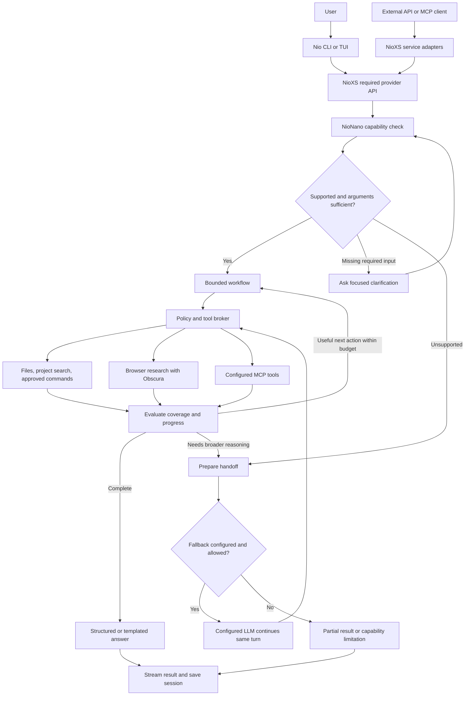
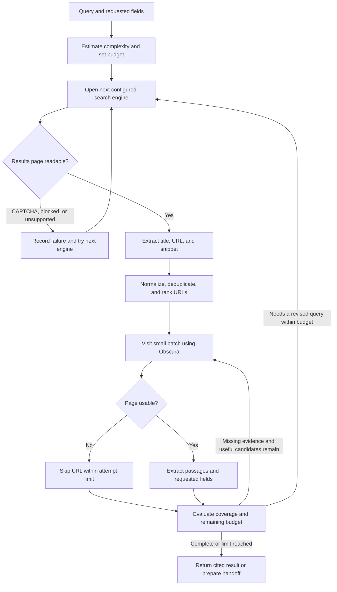
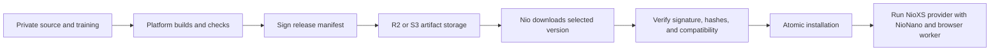

# NioXS and NioNano: design and implementation plan

Status: proposed design, not implemented. Revised 2026-10-09. See [NIOXS_ROADMAP.md](NIOXS_ROADMAP.md) for milestones and execution order.

## 1. Product decisions

- NioAI (`nio`) remains the terminal product and owns project access, approvals, tool execution, sessions, and output.
- NioNano (`nio-nano`) becomes the default model for new installations and requests without an explicit saved override, selected through the NioXS provider.
- NioXS is the required provider for NioNano, analogous to Kilo. Nio connects to its configured API endpoint; there is no direct NioNano bypass. The endpoint can be hosted or self-hosted locally. MCP is an additional interface.
- NioNano is a non-LLM controller: executable workflows, parsers, retrieval, and small predictive ML models. It is not an unrestricted language generator.
- NioNano executes in the NioXS deployment: local for self-hosting, remote for hosted service. Client project files and commands remain under Nio's tool broker. Unsupported tasks can automatically continue on the user's configured LLM, with a visible handoff.
- Obscura is the only browser engine. No Chromium installation, download, or fallback.
- Browser search requires no search API key. Blocked search engines and blocked destination pages are skipped separately.
- Research page budgets adapt to complexity and observed coverage.
- Proprietary NioNano/NioXS implementation and training remain in private repositories. Distribute binaries and model artifacts through R2 or S3.
- NioGuru is a possible future consumer through Nio or NioXS; it is not the initial integration target.

## 2. Component boundaries

| Component | Responsibilities | Does not own |
| --- | --- | --- |
| Nio | UI, project trust, modes, approval, native tools, session storage, cancellation | Proprietary inference implementation |
| NioXS | Required provider endpoint, model catalog, request routing, capability metadata, API and MCP adapters | Independent permission to execute client host commands |
| NioNano | Intent recognition, argument extraction, workflow selection, ranking, completion checks, action proposals | Permission grants or arbitrary LLM-equivalent generation |
| Obscura worker | Browser navigation, JavaScript execution, DOM/link/text extraction | Task planning or CAPTCHA solving |
| Optional Crawl4AI worker | Filtering and structured extraction without LLM extraction | Mandatory Chromium dependency |
| LLM adapter | Existing configured provider execution after handoff | New or elevated tool permissions |
| Artifact manager | Signed manifests, download, verification, atomic installation, version selection | Inference or web research routing |

NioNano proposes typed actions to a tool broker. Nio validates and executes them through its existing restrictions. The closed runtime never needs direct access to provider credentials or unrestricted shell execution in CLI mode.

Nio always requests NioNano through the NioXS provider API. A local deployment still exposes that API on loopback; a hosted deployment exposes a remote endpoint. The provider invokes its private runtime internally. R2/S3 downloads supply self-hosted installations and updates, while hosted clients do not need to download the model. Provider authentication is separate from search API keys; browser search remains keyless.

Client file and command actions return as provider tool calls for Nio to execute. Provider-side browser research runs only when the caller's web-tool policy permits it. A no-tools request disables both client and provider execution. Treat the two execution locations explicitly in the wire contract and progress events.

## 3. Architecture and full task flow



1. Resolve explicit model, saved preference, or new-install default `nioxs::nio-nano` (provider ID `nioxs`, model ID `nio-nano`).
2. Load the turn's existing project scope, mode, tools, attachments, deadline, and cancellation signal.
3. Nio sends NioNano requests to the NioXS provider endpoint. Explicit selections of existing LLM providers continue through their respective provider paths.
4. NioNano classifies the request into a supported workflow, unsupported intent, or clarification needed.
5. Extract validated arguments. A known workflow must have the inputs it needs before execution.
6. Execute bounded actions through the broker, preserving tool IDs and results in the session.
7. Reassess using workflow-specific completion checks. Continue only when a next step can improve the result.
8. Return a source-grounded result or hand off once to the configured LLM.
9. The LLM receives completed work and pending questions, uses the same broker, and completes the turn.
10. Save the actual backend path. The next new turn starts from the selected default again. Resolve follow-up intent from task state; route an ongoing unsupported coding task back to the LLM without repeating earlier actions.

## 4. First-release capabilities

| Workflow | NioNano result | Delegate when |
| --- | --- | --- |
| Inspect project | Languages, framework evidence, package scripts, relevant files | User needs architectural interpretation beyond predefined checks |
| Search project | Ranked file matches and exact excerpts | User asks for arbitrary code explanation or implementation |
| Run checks | Approved test/build/lint results and parsed failures | Failure requires an unfamiliar diagnosis or repair |
| Web lookup | Relevant passages, titles, URLs, access times | Question needs an original synthesis beyond extraction |
| Package comparison | Available metadata and source-linked comparison fields | User needs contextual recommendations unsupported by extracted fields |
| Structured extraction | Validated fields from JSON, CSV, or known page schemas | Inputs do not match a supported schema |

Later additions: deterministic repairs, parser-based refactoring, richer document processing, data profiling, and named automation workflows. Nio's optional document readers remain reusable. Arbitrary skills written in natural language do not become executable workflows simply by being read.

## 5. Browser research flow



Search-engine adapters are versioned modules with query URL construction, result selectors, challenge detection, and redirect-link normalization. Start by testing Google and alternative engines on actual queries; choose the default order from observed extraction reliability, not assumptions. Require no API keys.

Skip CAPTCHA, access-denied, login-required, and unsupported pages. Do not attempt to solve challenges. Apply a short cooldown to a blocked engine/domain instead of immediately retrying it. If every engine fails, use provided URLs or return the clear limitation. An LLM handoff cannot automatically cure unavailable web access.

Use normal HTTP fetch for simple destination pages when it yields valid readable content; use Obscura for rendered content and browser search. Preserve HTTP status, canonical URL, source URL, and fetch time. Challenge pages must not enter the evidence store as articles.

Initial Obscura integration uses its standalone CLI or CDP endpoint. Obscura documents link, text, HTML, and Markdown output. Keep the worker separate, start it on demand, and terminate it after an idle period.

Crawl4AI is optional. Test its CDP connection against Obscura for navigation, waits, extraction, timeouts, and cleanup. Do not run setup that installs Chromium. If the integration requires unsupported browser behavior, use Obscura extraction and Rust processing; do not introduce Chromium. Disable all Crawl4AI LLM extraction and schema-generation paths for local workflows.

## 6. Adaptive budgets and stopping

Proposed initial limits; tune against measurements before release:

| Complexity | First batch | Successful-page ceiling | Candidate-attempt ceiling | Web deadline |
| --- | ---: | ---: | ---: | ---: |
| Lookup | 1 | 2 | 5 | 30 seconds |
| Explanation/troubleshooting evidence | 2 | 5 | 10 | 60 seconds |
| Comparison | 3 | 8 | 16 | 90 seconds |
| Broad research | 4 | 12 | 24 | 120 seconds |

Initial concurrency: 2 destination pages. Search-engine attempts: at most 3 per workflow. Navigation timeout: up to 15 seconds, shortened to fit the remaining deadline. Query refinements, redirects, downloaded bytes, followed links, and extracted text also need caps; successful pages alone are not a sufficient resource limit.

Complexity signals: number of requested entities and fields, explicit comparison, breadth, recency requirements, and research depth. Narrow official-source lookups can stop after one page. Comparisons may require a row for every option and evidence for every requested field. Allow one useful same-site link-following step within the same candidate budget, such as homepage to documentation.

Expansion signals: missing fields, inaccessible primary sources, conflicting extracted values, and uncovered subquestions. Stopping signals: completion checks pass, new pages are repetitive, candidates are exhausted, the deadline expires, or the user cancels.

For open-ended questions, relevance and domain diversity measure retrieval coverage, not truth or complete understanding. Label partial results and delegate synthesis when necessary. Do not claim a precise confidence percentage without calibrated evidence.

## 7. Local ML and training

Bootstrap with explicit intent rules and tested workflows. This creates a useful controller but should not be represented as a trained model before training exists.

The first learned artifact can be a small intent/capability classifier trained in Python, using word/character features and a linear classifier. Export vocabulary, weights, labels, and calibration metadata for Rust inference. Consider a learned relevance ranker only after a lexical retrieval baseline is evaluated. No LLM or generative model is required.

Training examples contain request text, expected workflow, required arguments, completion outcome, and whether fallback was needed. Include unsupported, ambiguous, adversarial, and unrelated requests, not just supported examples. Split evaluation by task families and projects to avoid measuring memorization.

Measure false acceptance of unsupported tasks, workflow success, fallback precision, retrieval relevance, field extraction accuracy, and CPU/memory/latency. Compare the learned classifier with the rule baseline before enabling it. Keep an abstain path for unfamiliar input.

Feedback collection is optional and scoped to the deployment by default. For local deployments, there is no automatic upload of prompts, project files, or tool outputs. Hosted inference necessarily sends request context and client-executed tool results to the NioXS endpoint; that does not authorize retaining them as training data. Retraining and artifact publication are explicit maintainer workflows, not uncontrolled learning during every session.

## 8. LLM handoff semantics

Fallback triggers: unsupported capability, validated classifier abstention, required reasoning outside a workflow, or repeated lack of useful progress within the workflow budget. A single tool failure is not enough.

Do not hand off to evade a denied approval, restricted project scope, user cancellation, or local-only policy. Distinguish missing user input from missing capability: clarify inputs rather than spending an LLM call unnecessarily. Network outages and CAPTCHA exhaustion can remain partial results.

Handoff packet:

- Original request and relevant conversational context.
- Allowed tools, project scope, current mode, and remaining turn budget.
- Completed actions, tool-call IDs, errors, and any side effects already applied.
- Source-linked excerpts, extracted fields, and timestamps.
- Explicit gaps and reason for escalation.

Keep complete tool-call/result groups when converting to provider messages. Compact irrelevant output to Nio's existing context budget. Re-read current file state before an LLM proposes edits following earlier actions.

Display `NioNano → <configured LLM>: <reason>` as a status event. Automatic means no extra confirmation for each handoff when fallback policy is enabled; existing edit and command approvals still apply. A remote fallback sends relevant context to that configured provider. Local-only users can disable it or choose a local LLM endpoint.

For fallback to an existing user-configured provider, NioXS returns an explicit handoff state and Nio orchestrates continuation through that provider. Keep user provider credentials in Nio rather than forwarding them to NioXS. A separately configured NioXS-managed fallback can be added later. No LLM configured: return supported findings and state the remaining limitation. Limit handoff to one per turn initially, avoid circular gateway routing, and bound subsequent provider retries. Do not silently save the fallback LLM as the new default.

## 9. NioXS API compatibility

NioXS is a mandatory provider boundary for NioNano, with hosted and self-hosted deployment options. It provides a documented subset of the OpenAI-compatible interface; compatibility describes API shapes, not OpenAI-level model intelligence.

First API scope:

- `GET /v1/models`: advertise `nio-nano` and explicitly registered backends.
- `POST /v1/chat/completions`: text messages, bounded responses, streaming, standard errors, and a documented parameter subset.
- Capability endpoint: workflow support, modalities, fallback policy, artifact readiness, and tool-execution mode.
- Nio-specific progress/routing events through a separate event interface, keeping standard Chat Completions chunks interoperable.

Define routing profiles: auto fallback, local-only, and explicit backend. An explicit LLM selection honors that choice. A `nio-nano` request can use configured fallback only where the client/deployment policy permits it; disclose actual execution metadata separately from the requested model identity. Unsupported capabilities and parameters return explicit errors, not silently invented behavior.

Use two tool modes:

1. Client-executed: return typed tool calls; the caller executes them and returns results. NioNano chooses only supported mappings. Unknown caller-provided tools can cause abstention or policy-approved LLM handoff.
2. Server-executed: run only named workflows and tools enabled for a specific server workspace. Host file and command access is disabled by default for generic API requests.

Do not execute arbitrary client-supplied tool names or let an HTTP request invent a filesystem root. A hosted NioXS accesses its server workspace; it cannot inspect a user's laptop without a separate authorized local worker.

Start with Chat Completions compatibility tests. Add a Responses API adapter later only with separate schema and event tests. Multimodal generation, embeddings, fine-tuning, and every OpenAI parameter are outside the initial compatibility claim. Report actual usage when available; do not fabricate LLM token accounting for a non-generative local controller.

## 10. MCP roles

MCP is a tool protocol, not a replacement model API. Support two distinct roles:

- MCP client: Nio's tool broker connects to configured servers and makes approved tools available to supported workflows or the fallback LLM.
- MCP server: NioXS exposes a narrow initial tool catalog such as web research and structured extraction to other clients.

Start with stdio for local integrations. Add Streamable HTTP for remote integrations after authentication, workspace isolation, cancellation, and quotas are implemented. Pin and negotiate the supported MCP protocol version against target clients.

Suggested first exported tools: `web_search`, `read_webpage`, and `research_sources`. Project search and check execution require explicit workspace capability. Discovery alone does not teach NioNano how to use an arbitrary tool; unknown schemas need a configured workflow mapping or LLM handoff.

All entry points use the same policy broker. Tool descriptions, pages, files, and results are data, not instructions that can grant permissions. External-tool execution must preserve cancellation and bounded output.

## 11. Nio integration and repository strategy

Existing integration points in `src/main.rs`:

- `UserConfig`: add NioNano/fallback/artifact preferences without leaking private implementation.
- `chosen_model`, saved-model validation, provider resolution, and model catalogs: register NioXS and discover `nio-nano` through its provider catalog.
- `run_agent_turn` and `run_agent_turn_inner`: execute the provider tool loop and handle an explicit handoff state with shared lifecycle handling.
- Tool dispatch and history handling: execute NioXS-returned tool calls through the existing broker.
- CLI/TUI headers and JSON streams: show requested and active backend, progress, and handoff.

Keep Nio's adapter and wire contracts reviewable in this repository; place proprietary runtime, training code, and proprietary weights in private repositories. Do not place secret model implementation in the existing public MIT source and expect binary distribution to conceal it.

Proposed CLI surface, not implemented commands:

```text
nio run -m nioxs::nio-nano "Find relevant SQLite packages"
nioxs install
nioxs status
nioxs update
nioxs serve
nioxs mcp --stdio
```

Client configuration includes the NioXS provider endpoint, authentication if required, default model, explicit fallback model, and fallback mode. Provider deployment configuration owns search engine order, browser path/version, adaptive budget profile, and extraction backend. Preserve saved explicit LLM preferences during upgrades; only change an existing preference through an intentional user setting. Fresh installs default to NioXS's NioNano once the release gates pass.

Honor `--no-tools`, `--no-project-tools`, project trust, Ask/Plan/Build mode, `--auto`, and existing undo behavior. When tools are disabled, NioNano must not fetch, browse, or execute commands through a hidden path.

## 12. Distribution and installation flow



Package runtime, trained model files, Obscura version, contracts, and notices independently so browser updates do not require redownloading every model. Start with Linux x86_64, then macOS ARM64; add other supported platforms after worker availability and integration checks pass.

A signed manifest includes platform, version, artifact URLs, sizes, hashes, minimum Nio version, protocol version, model schema, and dependency versions. Verify against a public key embedded in the installer, extract safely, and install atomically. Keep the last known working version and support explicit version pinning and rollback. Never treat a checksum alone as publisher authentication.

Default deployment can use public binary downloads with private source. Restricted downloads can use temporary URLs. Never embed bucket write credentials in a distributed executable. R2/S3 is artifact storage, not the inference gateway.

Bundle dependency licenses and notices for each pinned release. Crawl4AI's current LICENSE includes additional attribution text and calls out CLI help/usage attribution; this affects packaging even if NioNano remains proprietary. Retain Obscura notices as required by its pinned distribution. Validate final redistribution requirements against the actual release artifacts.

## 13. Implementation phases and acceptance gates

| Phase | Deliverable | Completion evidence |
| --- | --- | --- |
| 0: Feasibility | Obscura search adapters, extraction corpus, optional Crawl4AI compatibility probe | Search-to-page flow on representative sites; CAPTCHA detection; no Chromium executable or browser download |
| 1: Provider and controller | NioXS model catalog and Chat Completions subset, internal worker protocol, broker adapter, project workflows | Nio requests NioNano through provider API; restrictions hold; cancellation and tool loop work |
| 2: Adaptive research | Ranking, budgets, engine switching, cache, extraction reports | Stops early on lookup; expands comparison coverage; blocked pages bounded and excluded |
| 3: Learned model | Trained classifier, Rust inference, calibrated abstention | Beats baseline on held-out tasks without unacceptable unsupported-task acceptance |
| 4: Handoff | Explicit fallback config, packet conversion, visible route events | Same task continues; no repeated side effects; disabled/missing fallback is handled |
| 5: Interface expansion | Broader API conformance and MCP server/client adapters | SDK/schema/stream tests pass; API and MCP execution respect workspace policy |
| 6: Distribution | Private CI builds, signed manifests, R2/S3 installer | Integrity rejection, atomic update, rollback, clean-machine execution |
| 7: Default rollout | NioNano default for new installations, preserved saved choices | End-to-end success and resource measurements meet documented release targets |

Do not make NioNano the production default before capability, artifact availability, and fallback behavior are proven. The prototype can be opt-in while the final product behavior remains NioNano-first.

## 14. Validation and operational limits

Use deterministic fixtures for parser and state-machine tests; opt-in live-site smoke tests for engine compatibility. Live web tests are observations, not deterministic correctness guarantees.

Required meaningful checks cover:

- Routing supported/unsupported/ambiguous requests and respecting explicit model selection.
- Tool restrictions across CLI, API, and MCP; denied approvals do not cause a bypass.
- CAPTCHA at search and destination stages, redirects, duplicate pages, robots handling, and unusable content.
- Adaptive expansion, early stopping, candidate ceilings, deadlines, extraction byte limits, and cancellation.
- Handoff preserves tool groups, side effects, history, and the existing context budget.
- Streaming emits valid NDJSON for Nio and valid SSE for the compatibility API, with completion and error behavior distinguished.
- Worker failure or missing artifacts yields a clear result or configured fallback, never an installation loop.
- Clean installation contains no Chromium; optional Crawl4AI never triggers a browser download.
- Manifest verification, corrupt/incompatible artifacts, interrupted updates, and rollback.

Measure local workflow completion, incorrect capability acceptance, fallback rate/reason, useful sources per visited page, blocked-page rate, median/tail latency, installation size, and peak memory. Browser and extraction dependencies determine actual footprint; avoid claiming a size or speed before measurement.

Keep local caches bounded, scoped appropriately, timestamped, and clearable. Do not persist credentials, sensitive pages, or raw project contents as global research cache entries. Bind local control services to loopback by default. Remote services need explicit access controls and per-workspace limits.

## 15. Dependencies and sources checked

- [Nio stream contract](STREAM.md) and [Nio CLI/host protocol](PROTOCOL.md).
- [Obscura capabilities and compatibility limitations](https://github.com/h4ckf0r0day/obscura).
- [Crawl4AI browser/CDP configuration](https://docs.crawl4ai.com/core/browser-crawler-config/).
- [Crawl4AI license and attribution](https://github.com/unclecode/crawl4ai/blob/main/LICENSE).
- [Obscura license](https://github.com/h4ckf0r0day/obscura/blob/main/LICENSE).
- [Official OpenAI Chat Completions API](https://developers.openai.com/api/reference/resources/chat/subresources/completions/methods/create).
- [Official MCP architecture](https://modelcontextprotocol.io/docs/learn/architecture).
- [R2 custom-domain downloads](https://developers.cloudflare.com/r2/buckets/public-buckets/).
- [S3 object sharing](https://docs.aws.amazon.com/AmazonS3/latest/userguide/using-presigned-url.html).

Unresolved engineering gates: real search-engine reliability without API keys, Obscura compatibility on the target site corpus, optional Crawl4AI operation without Chromium, trained-model benefit, platform footprint, and exact compatibility scope demanded by initial external clients. Address these in the phases above; none is a promise of universal browsing or LLM-equivalent capability.
