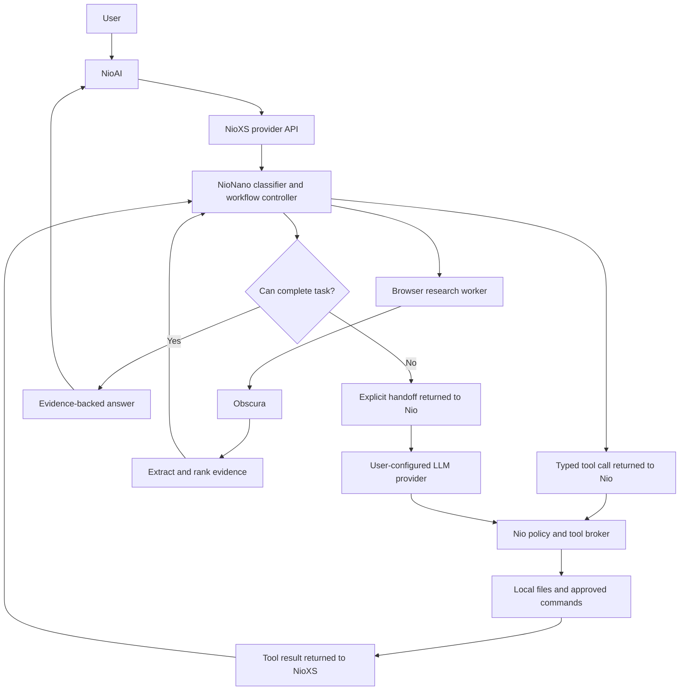

# NioXS and NioNano roadmap

Status: planning only. Prepared 2026-10-09. Architecture and detailed flows: [NIOXS_PLAN.md](NIOXS_PLAN.md).

## Product identity and scope

**NioXS — the axis of Nio's non-LLM models.**

- Product: NioAI, executable `nio`.
- Required provider: NioXS, provider ID `nioxs`.
- First model: NioNano, model ID `nio-nano`.
- Future family: NioMini, NioCore, NioMax, NioUltra; names reserved in the design, with capabilities and resource tiers to be defined after Nano evaluation.
- Selection: `nioxs::nio-nano`.
- Default behavior: NioNano first, automatic continuation on an explicitly configured LLM when necessary.
- Browser: Obscura only; no Chromium.
- Search: browser-based, without search API keys; skip CAPTCHAs and blocked pages.
- Distribution: private implementation, downloadable binaries and artifacts on R2 or S3.

NioNano first means build one useful model and its minimum provider surface before expanding into a model platform. No Mini/Core/Max/Ultra implementation until Nano is evaluated and released.

NioXS is mandatory even for a local installation: `nio` connects to a loopback NioXS API, which runs NioNano. Hosted NioXS is a second deployment of the same contract. A local-first pilot is the proposed implementation order, not a requirement that every future user self-host.

## Architecture



Browser research can run in the provider deployment when the request permits web access. For deployments that require browser execution on the client, use a Nio client tool instead. Project files and commands always stay under the client broker in the initial design. Provider-side tools and client-side tools need distinct ownership to avoid duplicated execution.

## Repository and implementation choices

Proposed private repository `nioxs` contains the provider service, Nano runtime, browser worker, artifact manager, and training/evaluation utilities. Use Rust for the provider and runtime, Python for offline training. Crawl4AI remains an optional Python extraction component if it works with Obscura without installing Chromium.

The existing public `nio` repository contains only provider integration, handoff handling, client tool enforcement, and user-facing configuration. Private model code and weights are not committed here. Documentation in this workspace describes the design; it is not a secret implementation.

Suggested private structure, not created yet:

```text
nioxs/
  crates/
    provider/       HTTP API, catalogs, sessions, protocol adapters
    nano/           features, model inference, workflows, completion checks
    browser/        Obscura integration and search adapters
    artifacts/      signed manifest and install/update logic
  training/         datasets, training, calibration, export
  evaluation/       fixtures, task corpus, live browser smoke tests
  contracts/        request, action, result, capability, handoff schemas
```

## Milestones

Milestones follow dependencies rather than fixed dates. Re-estimate calendar time after the browser spike and API/tool-loop prototype establish the difficult parts.

| Milestone | NioXS work | NioNano work | Exit gate |
| --- | --- | --- | --- |
| M0: Contracts and evidence | Define provider IDs, capability schema, tool ownership, and handoff extension | Define supported intents; build representative browser and task corpus | Document wire examples and demonstrate search-to-page extraction without Chromium |
| M1: Working vertical slice | Catalog, text Chat Completions subset, streaming, model validation, internal worker lifecycle | Rules-only project inspection and file search workflows | Nio selects `nioxs::nio-nano`, executes one client tool, returns its result, and completes the task |
| M2: Research prototype | Request deadlines, browser permissions, bounded progress, session continuation | Search adapters, extraction, lexical ranking, source reports, adaptive page budgets | Lookup stops early; comparisons expand; CAPTCHA engine/page failures are bounded |
| M3: Real Nano model | Load versioned model artifacts and expose readiness/version metadata | Python-trained classifier, Rust inference, argument validation, calibrated abstention | Held-out evaluation supports enabling the learned artifact over the baseline |
| M4: Automatic handoff | Explicit handoff response and Nio integration; fallback metadata | Detect unsupported intent and lack of progress; build evidence packet | Same task continues on configured LLM without replaying side effects or elevating permissions |
| M5: Release candidate | Signed builds, R2/S3 publishing, install/update/rollback, clean deployment | Validate pinned workflows and model artifacts against release corpus | Clean-machine run succeeds; signature and corruption checks fail safely; no Chromium |
| M6: Interoperability | MCP server/client integration, SDK conformance, optional hosted pilot | Map known MCP tools to workflows; abstain on unknown capabilities | External client integration works with bounded, policy-enforced tools |
| M7: Stable default | Production Nio provider settings and preserved upgrade preferences | Nano success/resource measurements meet agreed release gates | Fresh installs default to Nano; existing explicit selections remain intact |

M6 can follow the core v0.1 release if full MCP support would delay validated Nano workflows. The API contract must allow future MCP integration from M0, and working model-provider support is mandatory from M1.

## Release sequence

### Prototype: M0–M2

Demonstrate project inspection, file search, and browser research through NioXS. This is a workflow prototype, not yet a trained-model release. Keep opt-in provider selection and avoid changing production defaults.

### Alpha: M3–M4

Deliver a real trained Nano classifier, local inference, explicit supported capabilities, and LLM handoff. Unsupported requests must abstain before unnecessary tool execution. A handoff to another provider is managed by Nio, with credentials remaining in Nio.

### NioXS/NioNano v0.1: M5

Ship the useful first model, minimum API compatibility, reliable fallback, and verified self-hosted artifacts. Initial platform: Linux x86_64, followed by macOS ARM64 when dependencies and worker checks pass. Hosted beta is optional after local behavior is verified.

### Interoperability and default rollout: M6–M7

Expand external-client support and MCP. Enable Nano by default after controlled usage validates capability boundaries and resource limits. Keep explicit local-only and LLM-only selections.

## Initial task workflows

1. **Inspect project:** identify files and manifests, detect project type, extract available commands, report direct evidence.
2. **Find code:** extract search terms and optional file filters, search, rank matches, return exact snippets and paths.
3. **Run checks:** detect an explicitly supported configured command, request existing approval, run it, parse output, report failures. Never accept arbitrary generated shell strings as a workflow shortcut.
4. **Research sources:** form bounded queries, read search results, choose URLs, visit small batches, return source-linked passages.
5. **Compare packages:** fill named comparison fields from accessible metadata/documentation, preserve missing fields and conflicts.

Large novel features, original prose, creative design, and unfamiliar code fixes are outside the first local capability set. They can hand off immediately. Rules and trained classification select workflows; tools implement the actual actions.

## Adaptive research policy

| Request | Initial successful-page target | Maximum successful pages | Maximum destination attempts |
| --- | ---: | ---: | ---: |
| Lookup | 1 | 2 | 5 |
| Evidence for explanation/debugging | 2 | 5 | 10 |
| Comparison | 3 | 8 | 16 |
| Broad research | 4 | 12 | 24 |

Begin with two concurrent destination reads and at most three search-engine attempts. Apply separate deadlines and byte limits from the design document. These numbers are tunable starting points, not required page counts.

Complexity is estimated from task intent, requested entities, requested fields, breadth, and recency. Coverage determines expansion. If an official page supplies all required fields, stop. If content is repetitive or no useful candidates remain, stop. If sources conflict, gather additional evidence within budget or report the conflict.

CAPTCHA on a results page means try another engine. CAPTCHA on a destination means skip that URL. Never count challenge content as successful evidence. If no sources are accessible, return the access limitation; a model switch does not guarantee better browser access.

## Provider and handoff contract

The compatibility API starts with `/v1/models` and text `/v1/chat/completions`, including streaming and standard tool-call/result handling. Keep progress and handoff details in a documented NioXS extension instead of inventing OpenAI finish reasons or masquerading a handoff as an executable tool.

M0 must choose the exact extension schema and stream behavior. Required invariants:

- Clients can determine requested model, actual execution path, turn ID, and whether continuation is needed.
- A standard API client can receive a supported answer or a clear capability limitation without understanding Nio-specific handoff.
- Nio understands the handoff extension and automatically continues only when its policy permits.
- Partial progress is never marked as a completed answer before handoff settles.
- Stateful workflow continuation is correlated and isolated, with bounded state lifetime; replayed requests cannot rerun previously applied edits or commands.
- Provider-side browser execution respects `--no-tools` and caller permissions, even though it does not call Nio's local tool dispatcher.
- NioXS does not receive user LLM-provider credentials for the initial fallback design.

A follow-up to an already delegated coding task should retain task context and delegate again directly when necessary. Starting new turns with Nano must not restart the original work.

## MCP rollout

First exported tools: research and webpage extraction. First consumed tools: explicitly configured, schema-mapped capabilities. Tool discovery does not make arbitrary tools understandable to Nano.

Local stdio first; remote Streamable HTTP later with deployment policy and negotiated protocol support. API and MCP reuse the same execution and permission logic. A hosted MCP endpoint can access only its authorized workspace, not arbitrary caller files.

## Distribution flow

```text
Private source + training data
    → Evaluate and build pinned versions
    → Produce signed manifest + platform artifacts
    → Publish immutable version paths on R2/S3
    → Download and verify on deployment host
    → Start NioXS API with Nano and Obscura
    → Configure Nio's nioxs provider endpoint
```

Hosted mode: users configure the NioXS endpoint; the operator manages artifacts. Self-hosted mode: users download artifacts and run NioXS locally. Closed source does not imply offline execution when the configured endpoint is remote.

Keep runtime, model artifacts, and Obscura independently versioned, but require a tested compatible bundle. Include dependency notices and required Crawl4AI attribution if used. Public downloads can coexist with private source. Never distribute storage write credentials.

## Acceptance and measurement

Before M0 ends, record the evaluation corpus and provisional quantitative thresholds. Adjust targets only with documented evidence; do not make up latency, memory, or accuracy guarantees now.

Track supported task completion, incorrect unsupported-task acceptance, abstention behavior, useful evidence coverage, fallback reasons, tool replay, blocked-page frequency, latency, peak memory, and artifact footprint. Report results by workflow rather than one flattering aggregate score.

Release-blocking checks: permissions hold, cancellations stop work, handoff is explicit, sources match extracted facts, incomplete results are labeled, budgets are bounded, model/artifact versions are identifiable, rollback works, and no Chromium installation occurs. Use fixtures for reproducible tests and live smoke tests for browser compatibility.

## Next concrete work

Start M0 with three proofs:

1. Search results to useful destination excerpts using Obscura only, across simple lookups and comparisons, including blocked-page fixtures.
2. A documented NioXS request, client tool call, tool result, final response, and handoff example.
3. A labeled intent/evaluation dataset specification distinguishing supported tasks, missing inputs, and tasks requiring LLM fallback.

The first milestone produces reviewable evidence and contracts. It does not require implementing the complete provider, training pipeline, MCP platform, or all future model tiers at once.
